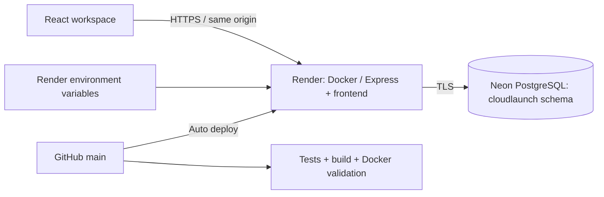
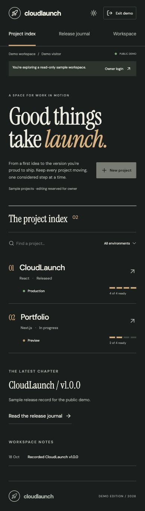
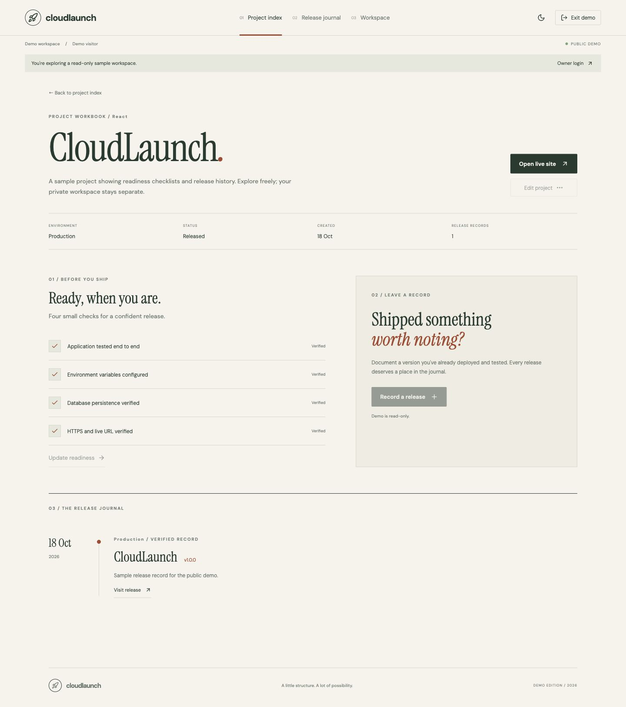
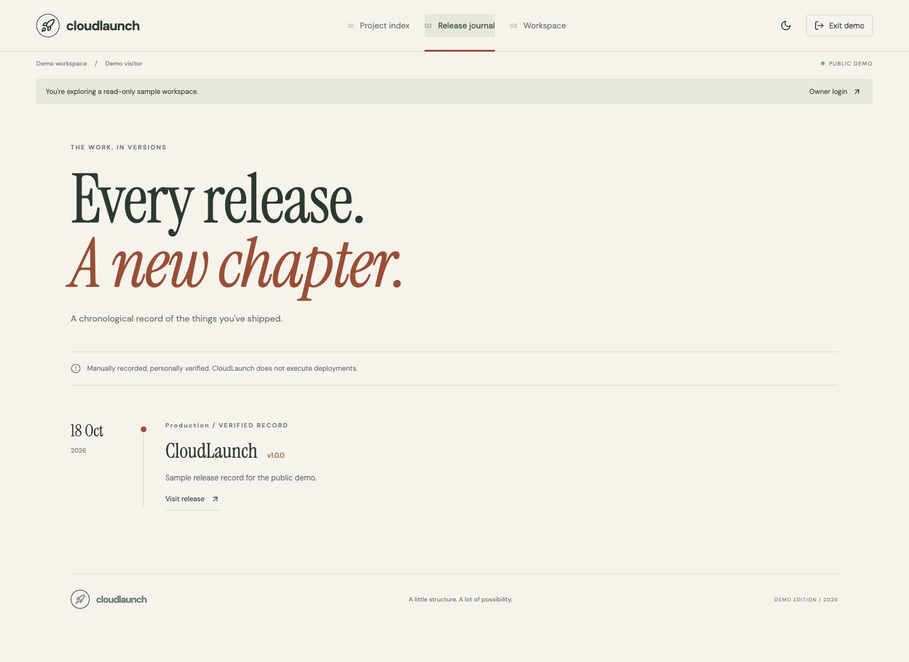
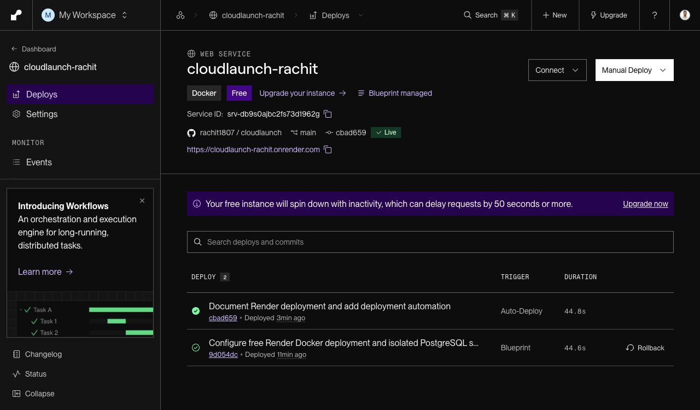

<div align="center">


# CloudLaunch

### A little progress. A big possibility.

A focused, responsive workspace for managing projects, preparing production checklists, and recording verified releases.

[](https://github.com/rachit1807/cloudlaunch/actions/workflows/ci.yml)

[Features](#features) · [Quick start](#quick-start) · [Architecture](docs/architecture.md) · [Cloud deployment](docs/deployment.md) · [API](docs/api.md)


**CodeMore · Week 4 · Task 3**  
Deploying a Web Application to a Cloud Platform

</div>

---


## Deployment

**Live application:** [cloudlaunch-rachit.onrender.com](https://cloudlaunch-rachit.onrender.com)

**Health endpoint:** [/api/health](https://cloudlaunch-rachit.onrender.com/api/health)

The app runs on a free Docker web service with managed PostgreSQL in Singapore.

Repository: [rachit1807/cloudlaunch](https://github.com/rachit1807/cloudlaunch)

**Platform choice:** Google Cloud deployment was attempted, but billing activation presented a ₹15,000 payment request during account setup. To keep this student project within a zero-cost hosting budget, the application was deployed on Render instead. The Google Cloud deployment configuration remains available for future use.

Render is a cloud hosting platform. This is a substitution for the assignment’s named AWS/Google Cloud/Azure targets, so acceptance remains at the reviewer’s discretion.

## Features

- **Project workspace:** create, edit, search, filter, and delete projects with environment and technology details.
- **Launch readiness:** track four explicit checks covering application testing, configuration, data persistence, and HTTPS.
- **Release journal:** record versioned releases after the checklist is complete and a valid HTTPS URL is supplied; duplicate versions are rejected.
- **Overview:** real project counts, release counts, readiness totals, and recent activity.
- **Persistent storage:** PostgreSQL in production, with a file-backed local development mode.
- **Workspace settings:** edit the workspace and owner names, and export data as JSON.
- **Light and dark themes:** remembered on the current device, with a flash-prevention theme initializer.
- **Responsive layout:** mobile navigation drawer, stacked project cards, responsive statistics, and scrollable dialogs.
- **Accessible interactions:** labelled controls, visible focus, dialog focus trapping, Escape to close, and reduced-motion support.
- **Production packaging:** multi-stage Docker image, non-root runtime, database health endpoint, graceful shutdown, and validation workflow.

> Release records are entered manually. CloudLaunch does not provision infrastructure, execute remote deployments, or automatically verify a project’s live URL. Readiness checks are confirmations made by the workspace owner.

## Quick start

Requirements: Node.js 24 and npm. Docker and a PostgreSQL server are optional for local development.

```bash
git clone https://github.com/rachit1807/cloudlaunch.git
cd cloudlaunch
npm ci
npm run dev
```

Open the local URL printed by Vite, normally `http://127.0.0.1:5173`. The development frontend forwards `/api` requests to Express on port 3001. Restart the backend after changing server files.

No credentials are required for local development. Local workspace data is saved in `.data/workspace.json`, which is ignored by Git. New workspaces start empty.

### Local production preview

```bash
npm run build
npm start
```

Open `http://localhost:3001`. This serves the built frontend and API from the same process. To test production configuration, supply `NODE_ENV=production`, `DATABASE_URL`, and `WORKSPACE_PASSWORD`.

### Use PostgreSQL locally

Copy `.env.example` to `.env`, replace its example values, and use Node’s environment-file support:

```bash
npm run build
node --env-file=.env src/server/index.js
```

The server creates the workspace table and its initial row automatically. An existing database and database user must already exist. Local `.env` files are ignored by Git; never commit real credentials.

## How to use CloudLaunch

1. Create a project with its name, description, stack, and environment.
2. Open its card to update details and tick the production checks you have completed.
3. Add the deployed HTTPS URL and save changes.
4. Select **Record a verified release**, enter a version such as `v1.0.0`, and add optional release notes.
5. Review the release journal and export your workspace from Settings when needed.

Deleting a project also deletes its associated release history. The interface asks for confirmation first.

## Technology

| Layer                 | Tools                                           | Purpose                                                                            |
| --------------------- | ----------------------------------------------- | ---------------------------------------------------------------------------------- |
| Interface             | React, JavaScript, CSS, Lucide                  | Project index, dedicated workbooks, release timeline, accessible forms, and themes |
| Build                 | Vite                                            | Development server and production assets                                           |
| API                   | Node.js, Express, Helmet                        | Validation, routes, security headers, and static asset serving                     |
| Database              | PostgreSQL via `pg`                             | Durable workspace data and transactional updates                                   |
| Containers            | Docker                                          | Repeatable frontend build and non-root production runtime                          |
| Hosting               | Render Docker web service and Neon PostgreSQL | HTTPS container hosting, managed relational storage, and environment secrets       |
| Optional cloud target | Google Cloud Run, Cloud SQL, Secret Manager     | Retained alternative deployment configuration                                      |
| Automation            | GitHub Actions                                  | API tests, production build, and Docker image validation                           |

## Architecture



See [architecture notes](docs/architecture.md) for data storage, concurrency, and security decisions.

## Configuration

| Variable             | Default       | Meaning                                                  |
| -------------------- | ------------- | -------------------------------------------------------- |
| `PORT`               | `3001`        | HTTP listening port; the Docker image defaults to `8080` |
| `NODE_ENV`           | unset         | Set to `production` on the cloud host                    |
| `DATABASE_URL`       | unset         | PostgreSQL connection string; required in production     |
| `WORKSPACE_PASSWORD` | unset         | Shared workspace password; required in production        |
| `DATA_DIR`           | `.data`       | Local fallback storage directory                         |
| `DATABASE_SCHEMA`    | `cloudlaunch` | Validated PostgreSQL schema for application tables       |

The production server refuses to start without a database URL and workspace password. The health endpoint and `/api/demo` sample-data endpoint are public; private workspace API routes require the configured password. The UI prompts for that password and stores it in the current tab’s session storage.

## Render deployment

The version-controlled [render.yaml](render.yaml) defines a free Docker web service in Singapore with `/api/health` readiness checks, automatic deploys from `main`, a manually supplied Neon database URL, and a generated workspace password.

The deployed app uses its own Neon PostgreSQL 16 project in Singapore, with a dedicated `cloudlaunch` database and database role. All application queries target `cloudlaunch.workspace`. It no longer shares TeamHub’s database or depends on the original Render database expiry.

For your own workspace, supply your own TLS-enabled PostgreSQL connection string as `DATABASE_URL` when applying the Blueprint. See the [Render deployment guide](docs/deployment.md).

For a manual redeploy after committing and pushing code:

```bash
export RENDER_SERVICE_ID="your-service-id"
# Set RENDER_API_KEY securely in your shell; never commit it.
./scripts/deploy.sh
```

The script runs validation, triggers one deploy through Render’s API, waits for its status to become live, and checks database health. Normal pushes already trigger auto-deploy; avoid triggering a duplicate while one is running.

**Free-plan limits:** the web service sleeps after 15 idle minutes and may take about a minute to wake up. This workspace shares 750 free instance hours monthly across its free web services. The Neon production database has **no scheduled expiry**. Free-plan storage, compute, transfer and recovery limits still apply; keep independent backups. No provider guarantees unlimited or perpetual free hosting. [Render free-plan documentation](https://render.com/docs/free)

The generated workspace password is available to the owner in the service’s Render **Environment** page under `WORKSPACE_PASSWORD`. It is intentionally not published in this repository. Visitors and reviewers should choose **Explore demo** on the login screen. It requires no password and displays isolated, read-only sample projects and releases. It never reads private workspace data or saves changes. Search, filters, navigation, themes, and sample-data export remain available.

**Keep `WORKSPACE_PASSWORD` private.** Do not publish it in the README, source code, screenshots, issues, or public submission notes. Owner login grants editing and deletion access to the private workspace; it is not a visitor credential. If the password has been disclosed, rotate it in Render’s Environment settings and redeploy. Individual visitor accounts are not provided.

### Optional Google Cloud setup

The original Google Cloud script is preserved as `scripts/deploy-gcp.sh`. Its prerequisites and configuration are documented in [the Google Cloud guide](docs/google-cloud.md). No Google Cloud services were provisioned.

## Validation

```bash
npm test
npm run build
node scripts/smoke.mjs http://localhost:3001
```

API tests cover the project lifecycle, invalid URLs, release prerequisites, duplicate release prevention, file persistence across store instances, password protection, and deletion of related releases. GitHub Actions also builds the Docker image.

Manual browser checks cover project creation, search, environment filtering, editing, mobile navigation, and light/dark appearance. See [validation notes](docs/validation.md) for current coverage and limits.

## Project structure

```text
cloudlaunch/
├── src/
│   ├── client/             # React interface and responsive styles
│   └── server/             # Express API and PostgreSQL/file storage
├── public/                 # Favicon
├── scripts/
│   ├── deploy.sh           # Render deployment entry point
│   ├── deploy-render.mjs   # Render API deploy and readiness verification
│   ├── deploy-gcp.sh       # Optional Google Cloud Run deployment
│   └── smoke.mjs           # Frontend and database health check
├── tests/                  # API integration tests
├── docs/                   # Architecture, deployment, API, screenshots
├── .github/workflows/      # Continuous validation
├── .env.example
├── .dockerignore
├── render.yaml             # Render Blueprint
├── Dockerfile
├── index.html
├── package.json
├── package-lock.json
└── vite.config.js
```

## Screenshots

| Desktop light                                                   | Mobile dark                                                 |
| --------------------------------------------------------------- | ----------------------------------------------------------- |
|  |  |







The screenshots above show the redesigned live Render demo. The interface uses a horizontal project index, dedicated project workbooks, a chronological release journal, and top navigation. Light mode uses warm paper and forest ink; dark mode uses deep green and copper accents. Mobile reorganizes the project rows and workbook sections into a single-column reading flow. Older design captures in this directory are historical.

## Scope

CloudLaunch is a personal shared workspace, not a multi-tenant hosting platform. It uses one workspace record, a shared password, and manual release recording. It has no individual user accounts, role system, automatic deployments, or infrastructure telemetry. The PostgreSQL model is intended for small personal workloads; a larger service should use normalized tables, user-based authorization, and distributed authentication rate limiting.

---

<div align="center">Built by <a href="https://github.com/rachit1807">Rachit Tripathi</a> · One idea at a time.</div>
