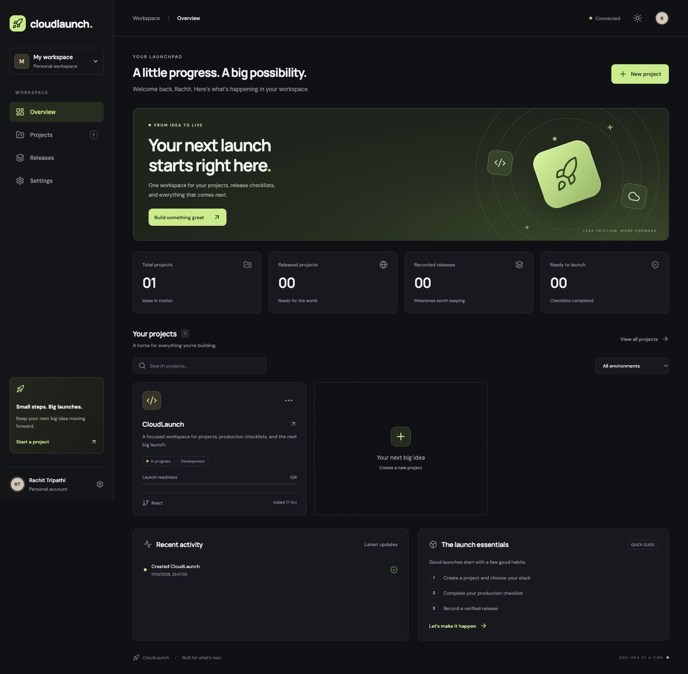
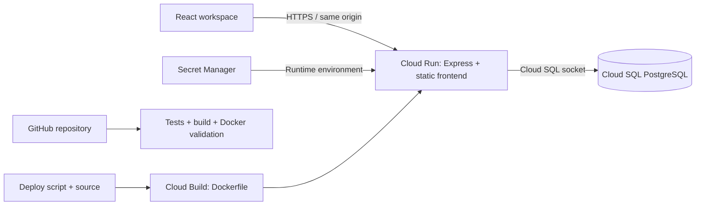
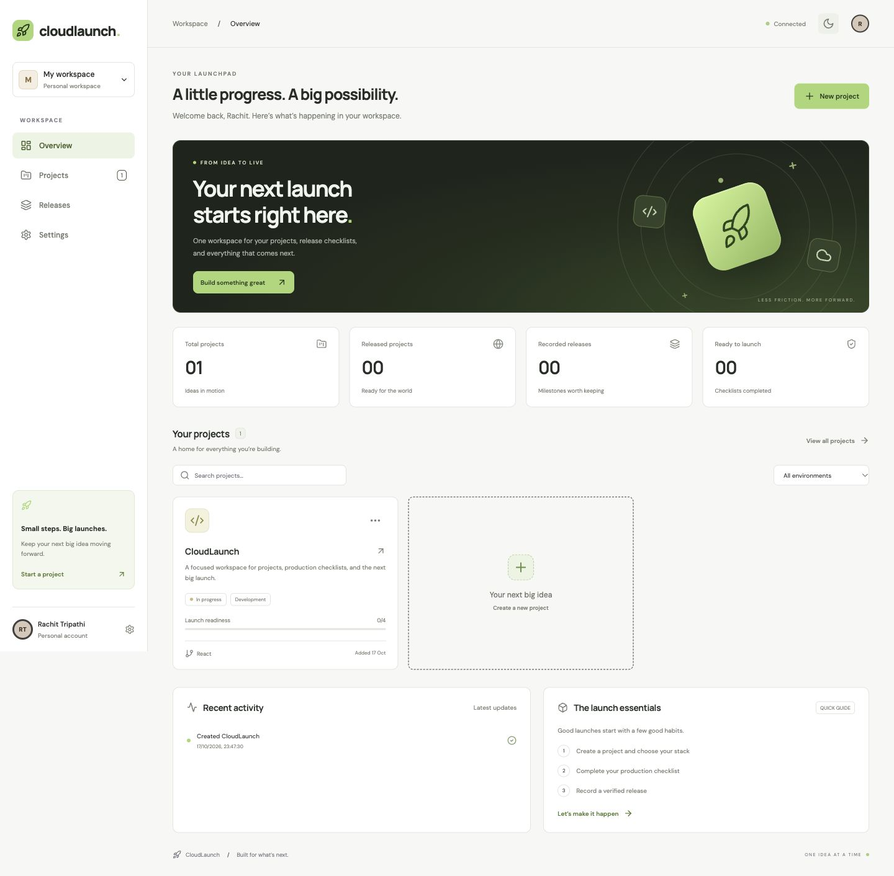
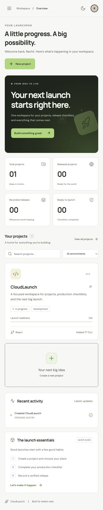

<div align="center">


# CloudLaunch

### A little progress. A big possibility.

A focused, responsive workspace for managing projects, preparing production checklists, and recording verified releases.

[Features](#features) · [Quick start](#quick-start) · [Architecture](docs/architecture.md) · [Cloud deployment](docs/deployment.md) · [API](docs/api.md)


**CodeMore · Week 4 · Task 3**  
Deploying a Web Application to a Cloud Platform

</div>

---



## Deployment status

The application is built and tested locally. Google Cloud Run and Cloud SQL deployment files are included. **A public live URL is pending Google Cloud account access and provisioning.** A local screenshot does not represent a live cloud deployment.

Repository: [rachit1807/cloudlaunch](https://github.com/rachit1807/cloudlaunch)

## Features

- **Project workspace:** create, edit, search, filter, and delete projects with environment and technology details.
- **Launch readiness:** track four explicit checks covering application testing, configuration, data persistence, and HTTPS.
- **Release journal:** record versioned releases after the checklist is complete and a valid HTTPS URL is supplied; duplicate versions are rejected.
- **Overview:** real project counts, release counts, readiness totals, and recent activity.
- **Persistent storage:** PostgreSQL in production, with a file-backed local development mode.
- **Workspace settings:** edit the workspace and owner names, and export data as JSON.
- **Light and dark themes:** remembered on the current device, with a flash-prevention theme initializer.
- **Responsive layout:** mobile navigation drawer, stacked project cards, responsive statistics, and scrollable dialogs.
- **Accessible interactions:** labelled controls, visible focus, dialog focus trapping, Escape to close, and reduced-motion support.
- **Production packaging:** multi-stage Docker image, non-root runtime, database health endpoint, graceful shutdown, and validation workflow.

> Release records are entered manually. CloudLaunch does not provision infrastructure, execute remote deployments, or automatically verify a project’s live URL. Readiness checks are confirmations made by the workspace owner.

## Quick start

Requirements: Node.js 24 and npm. Docker and a PostgreSQL server are optional for local development.

```bash
git clone https://github.com/rachit1807/cloudlaunch.git
cd cloudlaunch
npm ci
npm run dev
```

Open the local URL printed by Vite, normally `http://127.0.0.1:5173`. The development frontend forwards `/api` requests to Express on port 3001. Restart the backend after changing server files.

No credentials are required for local development. Local workspace data is saved in `.data/workspace.json`, which is ignored by Git. New workspaces start empty.

### Local production preview

```bash
npm run build
npm start
```

Open `http://localhost:3001`. This serves the built frontend and API from the same process. To test production configuration, supply `NODE_ENV=production`, `DATABASE_URL`, and `WORKSPACE_PASSWORD`.

### Use PostgreSQL locally

Copy `.env.example` to `.env`, replace its example values, and use Node’s environment-file support:

```bash
npm run build
node --env-file=.env src/server/index.js
```

The server creates the workspace table and its initial row automatically. An existing database and database user must already exist. Local `.env` files are ignored by Git; never commit real credentials.

## How to use CloudLaunch

1. Create a project with its name, description, stack, and environment.
2. Open its card to update details and tick the production checks you have completed.
3. Add the deployed HTTPS URL and save changes.
4. Select **Record a verified release**, enter a version such as `v1.0.0`, and add optional release notes.
5. Review the release journal and export your workspace from Settings when needed.

Deleting a project also deletes its associated release history. The interface asks for confirmation first.

## Technology

| Layer | Tools | Purpose |
| --- | --- | --- |
| Interface | React, JavaScript, CSS, Lucide | Responsive dashboard, accessible forms, themes, and icons |
| Build | Vite | Development server and production assets |
| API | Node.js, Express, Helmet | Validation, routes, security headers, and static asset serving |
| Database | PostgreSQL via `pg` | Durable workspace data and transactional updates |
| Containers | Docker | Repeatable frontend build and non-root production runtime |
| Cloud target | Google Cloud Run, Cloud SQL, Secret Manager | Container hosting, managed PostgreSQL, and runtime secrets |
| Automation | GitHub Actions | API tests, production build, and Docker image validation |

## Architecture



See [architecture notes](docs/architecture.md) for data storage, concurrency, and security decisions.

## Configuration

| Variable | Default | Meaning |
| --- | --- | --- |
| `PORT` | `3001` | HTTP listening port; the Docker image defaults to `8080` |
| `NODE_ENV` | unset | Set to `production` on the cloud host |
| `DATABASE_URL` | unset | PostgreSQL connection string; required in production |
| `WORKSPACE_PASSWORD` | unset | Shared workspace password; required in production |
| `DATA_DIR` | `.data` | Local fallback storage directory |

The production server refuses to start without a database URL and workspace password. The health endpoint is public; all other API routes require the configured password. The UI prompts for that password and stores it in the current tab’s session storage.

## Google Cloud deployment

Follow the complete [deployment guide](docs/deployment.md) to provision Cloud SQL, configure a runtime service account and Secret Manager, and publish to Cloud Run.

```bash
export GCP_PROJECT_ID="your-project-id"
export CLOUD_SQL_INSTANCE="your-project-id:asia-south1:your-instance"
export SERVICE_ACCOUNT="cloudlaunch-runtime@your-project-id.iam.gserviceaccount.com"
./scripts/deploy.sh
```

The script checks prerequisites, runs tests and the production build, deploys from the multi-stage Dockerfile through Cloud Build, attaches Cloud SQL, injects secret references, and checks the returned live URL. It assumes cloud infrastructure and IAM permissions have already been configured. Provisioning managed cloud resources may incur charges; review the project’s billing and budget settings before creating them.

## Validation

```bash
npm test
npm run build
node scripts/smoke.mjs http://localhost:3001
```

API tests cover the project lifecycle, invalid URLs, release prerequisites, duplicate release prevention, file persistence across store instances, password protection, and deletion of related releases. GitHub Actions also builds the Docker image.

Manual browser checks cover project creation, search, environment filtering, editing, mobile navigation, and light/dark appearance. See [validation notes](docs/validation.md) for current coverage and limits.

## Project structure

```text
cloudlaunch/
├── src/
│   ├── client/             # React interface and responsive styles
│   └── server/             # Express API and PostgreSQL/file storage
├── public/                 # Favicon
├── scripts/
│   ├── deploy.sh           # Google Cloud Run deployment
│   └── smoke.mjs           # Frontend and database health check
├── tests/                  # API integration tests
├── docs/                   # Architecture, deployment, API, screenshots
├── .github/workflows/      # Continuous validation
├── .env.example
├── .dockerignore
├── Dockerfile
├── index.html
├── package.json
├── package-lock.json
└── vite.config.js
```

## Screenshots

| Desktop light | Mobile light |
| --- | --- |
|  |  |

Screenshots show a local development workspace. Cloud infrastructure screenshots and the live application link should be added after the Google Cloud deployment is verified.

## Scope

CloudLaunch is a personal shared workspace, not a multi-tenant hosting platform. It uses one workspace record, a shared password, and manual release recording. It has no individual user accounts, role system, automatic deployments, or infrastructure telemetry. The PostgreSQL model is intended for small personal workloads; a larger service should use normalized tables, user-based authorization, and distributed authentication rate limiting.

---

<div align="center">Built by <a href="https://github.com/rachit1807">Rachit Tripathi</a> · One idea at a time.</div>
